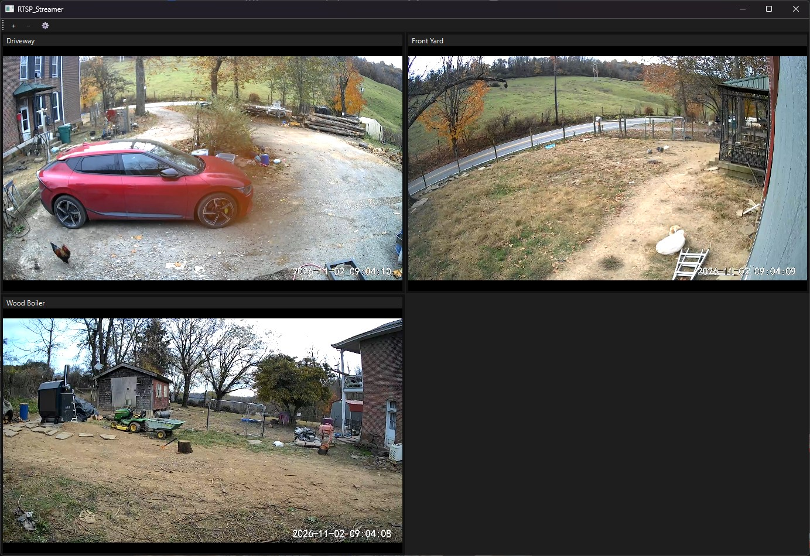

# RTSP_Streamer

[](https://github.com/IrrevocableNoob/RTSP_Streamer/actions/workflows/tests.yml)
[](LICENSE)

A lightweight, standalone **Windows desktop viewer for RTSP/IP camera streams**. Watch up to 16 live feeds in an auto-fitting grid, snapshot or record any tile, and keep it floating quietly in the background while you work. No web server, no cloud, no browser — just a native window backed by [VLC](https://www.videolan.org/).

> Built with Python + PyQt6 + [python-vlc](https://pypi.org/project/python-vlc/), leaning on your installed VLC for decoding.

---

## Screenshot

<!-- Add a capture of the running app as assets/screenshot.png and uncomment: -->
<!--  -->

_Screenshot coming soon. See [`assets/`](assets/) to add one._

## Features

- **Up to 16 concurrent RTSP streams** in a grid that auto-fits to how many you've added (1→full, 2→side-by-side, 3–4→2×2, up to 4×4).
- **Add / remove cameras from the UI** — a `+` dialog takes a name and the URL body (`user:pass@host:554/path`); the app prepends `rtsp://`. Remove is a selected-tile delete with confirmation.
- **Double-click to zoom** a tile to fill the window; double-click again to return to the grid.
- **Snapshot** any tile to PNG (right-click → Snapshot).
- **Record** any tile to MP4 (right-click → Start/Stop Recording), with a red indicator while recording.
- **Quiet auto-reconnect** — if a camera drops, the tile shows a "Reconnecting…" notice and retries on an exponential backoff (1s→30s). No pop-ups, never steals focus.
- **Hardware-accelerated decoding** by default (falls back to software automatically).
- **Persistent config** — your cameras and output folder are saved to `config.json` beside the app and reload on launch.
- **Credential-safe logging** — passwords in stream URLs are redacted in the log file.

## Requirements

- **Windows 10/11** (developed and tested on Windows 11).
- **64-bit [VLC](https://www.videolan.org/) 3.0 or newer**, installed. The app uses VLC's `libvlc` for decoding and **does not bundle it**. If VLC isn't found, the app shows a message and exits.
- **Python 3.11+** (works on 3.14).

## Install

```powershell
py -m venv .venv
.venv\Scripts\python.exe -m pip install -r requirements.txt
```

## Run

```powershell
.venv\Scripts\python.exe -m rtsp_streamer
```

On first launch, `config.json` and `app.log` are written next to the app. The default output folder for snapshots/recordings is `%USERPROFILE%\Videos\RTSP_Streamer` (changeable in Settings). Files land in `snapshots\` and `recordings\` subfolders, named `<stream>_<YYYYMMDD-HHMMSS>`.

### Adding a camera

Click **+**, give it a name, and paste the stream URL **without** the scheme, for example:

```
user:password@<camera-ip>:554/stream0
```

Consult your camera's documentation for its exact RTSP path. Streams are expected to be reachable on your local network.

## Recording notes

Recording captures **video only** (H.264, copied without re-encoding) straight to `.mp4`. Audio is intentionally dropped — many IP cameras emit G.711 (a-law/µ-law) audio, which the MP4 container cannot store. A clean **Stop Recording** finalizes a standard, widely-playable MP4.

## Limitations

- **Windows only.** The video embedding relies on Win32 window handles; macOS/Linux are not supported.
- **Video only** — no audio playback, no audio in recordings.
- **LAN-oriented.** Designed for cameras on your local network; there is no cloud relay, remote access, or NAT traversal.
- **No camera discovery / ONVIF** — you enter stream URLs manually.
- **Credentials are stored in cleartext** inside `config.json` (as part of the RTSP URL). Keep that file private. They are redacted in logs, but not encrypted at rest.
- **Crash-during-recording** may leave an unfinalized (possibly unplayable) MP4 — only an abrupt kill *while recording* is affected; normal Start/Stop is fine.
- **Recording opens a second connection** to the camera (independent of the on-screen tile). Cameras that cap simultaneous RTSP clients may refuse it.
- **No analytics, motion detection, or scheduling** — this is a plain live viewer.

## Development

```powershell
.venv\Scripts\python.exe -m pytest
```

The test suite runs fully headless and does not require VLC — the VLC layer is faked, so pure logic (config, URL handling, grid math, reconnect policy, recording state) is unit-tested in isolation. Live video, snapshot, and recording are verified manually against a real camera.

Project layout:

```
src/rtsp_streamer/
    config.py          config.json load/save (schema-versioned, crash-tolerant)
    urls.py            RTSP URL normalization + credential redaction
    logging_setup.py   rotating file log with password redaction
    grid.py            auto-fit grid geometry
    reconnect.py       backoff policy + reconnect supervisor
    vlc_backend.py     libvlc wrapper (decode, snapshot, record)
    tile.py            single-stream tile widget
    dialogs.py         add-stream / settings / delete-confirm dialogs
    main_window.py     toolbar, grid, selection, zoom, capture wiring
    app.py             application bootstrap + VLC availability check
    __main__.py        `python -m rtsp_streamer` entry point
tests/                 headless unit tests (VLC layer faked)
```

## License

[MIT](LICENSE)
